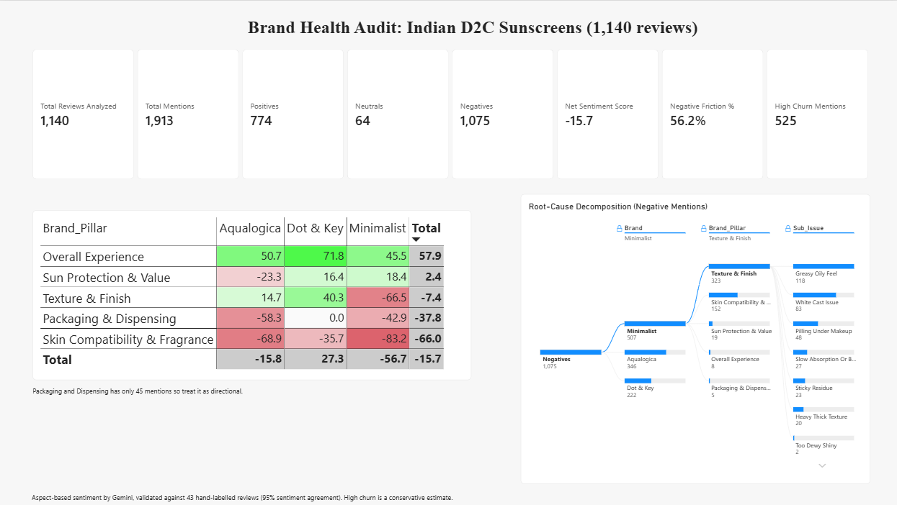
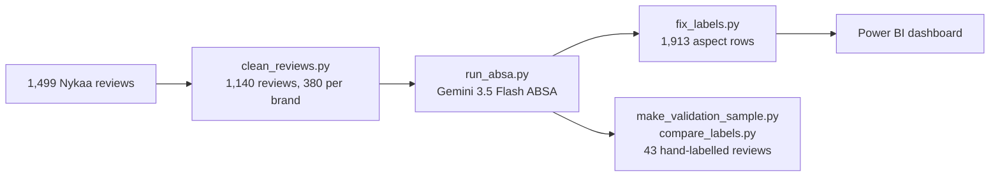

# Always-On Brand Health & Aspect-Based Sentiment Engine

### Indian D2C Sunscreens: Aqualogica vs Minimalist vs Dot & Key

An AI pipeline that reads 1,140 Nykaa reviews, splits each one into the specific things the reviewer liked or disliked, and turns them into a Power BI brand health dashboard and a repositioning plan for each brand.

**[📖 Read the case study](https://claude.ai/artifact/8fxeSZHuCwREwCQvokenLc)** · **[📊 Repositioning deck (PDF)](Sunscreen%20Brand%20Health%20Repositioning.pdf)** · [Interactive deck](https://claude.ai/artifact/VPvLiWXSMwXjmLCYoZUG4D)



---

## The problem

Brand health trackers from Nielsen or Kantar report every quarter, so brand teams hear about a problem roughly 90 days late. Basic sentiment analysis is faster but blunt: a review that says _"very light, no white cast, but it broke me out"_ gets one mixed score, and the actual defect is lost.

This project fixes both. It uses **aspect-based sentiment analysis (ABSA)**: every review is broken into its separate opinions, each tagged with a brand pillar, a specific issue, a sentiment and a churn risk. The data then shows exactly where each brand wins, where it loses, and which customers it is likely to lose.

## Key findings

|                                        | Dot & Key                         | Aqualogica                          | Minimalist                                |
| -------------------------------------- | --------------------------------- | ----------------------------------- | ----------------------------------------- |
| **Net Sentiment Score** (−100 to +100) | **+27.3**                         | −15.8                               | **−56.7**                                 |
| Reviews at high churn risk             | 80 (21.1%)                        | 131 (34.5%)                         | 123 (32.4%)                               |
| Biggest strength                       | Lightweight texture (81 mentions) | No white cast (48)                  | Sun protection, best of the three (+18.4) |
| Biggest problem                        | Pilling under makeup (30)         | Breakouts (47), skin darkening (44) | Greasy feel (118), white cast (83)        |
| Root cause                             | Usage, not formula                | Skin reactions → trust              | Wrong skin type is buying it              |

Across the category:

- **Texture is the conversation.** 53% of all 1,913 aspect mentions are about Texture & Finish, with 17× the complaints of packaging (534 vs 31).
- **Skin fit is the pain point.** 82% of Skin Compatibility mentions are complaints, the highest of any pillar.
- **The fixes target 6 in 10 at-risk customers.** 334 of 1,140 reviewers (29%) are likely to stop buying; 198 of them complain about a problem the recommendations below address.

## Recommendations

| Brand          | Intervention                                                                                                                                                                                                                                      |
| -------------- | ------------------------------------------------------------------------------------------------------------------------------------------------------------------------------------------------------------------------------------------------- |
| **Minimalist** | Front-of-pack **Skin-Type & Finish badge** ("Dry & normal skin", matte-to-dewy meter), readable on 150 × 150 px quick-commerce thumbnails, with a cross-sell to a matte variant for oily skin. White cast and pilling go to an R&D texture brief. |
| **Aqualogica** | Root-cause the skin reactions first (batches, formula, darkening vs under-application), then add patch-test and skin-type guidance and run non-comedogenic testing before claiming it.                                                            |
| **Dot & Key**  | Protect the texture that wins; fix pilling with usage guidance ("let it set before makeup") before asking R&D for a formula tweak.                                                                                                                |

Proof plan: A/B test the new pack image on Nykaa listings and compare 90-day repeat purchases; re-run this pipeline monthly to track Net Sentiment by pillar.

## How it works



1. **Clean and balance** (`clean_reviews.py`): repairs garbled emoji encoding, standardises brand names, drops 1 empty and 124 duplicate reviews, then randomly downsamples (seed 42) every brand to 380 reviews so brand counts are directly comparable.
2. **Extract aspects** (`run_absa.py`): sends reviews to Gemini 3.5 Flash with a strict `pydantic` schema. Each output row is one opinion:

   | Column            | Values                                                                                                                   |
   | ----------------- | ------------------------------------------------------------------------------------------------------------------------ |
   | `Brand_Pillar`    | Texture & Finish · Packaging & Dispensing · Skin Compatibility & Fragrance · Sun Protection & Value · Overall Experience |
   | `Sub_Issue`       | 2–4 word label, e.g. _Greasy Oily Feel_, _No White Cast_, _Causes Breakouts_                                             |
   | `Sentiment_Score` | 1 positive · 0 neutral · −1 negative                                                                                     |
   | `Churn_Risk`      | High (won't rebuy, returned, warns others, skin reaction) · Low                                                          |

   Built for the free tier's 20 requests per day: 60 reviews per call (19 calls in total), thinking disabled, a save after every batch, and resume-on-rerun.

3. **Fix label direction** (`fix_labels.py`): Gemini sometimes reused a label in the opposite sense ("Good Value Price" scored negative). The script renames 266 of 1,913 labels to match their score, without touching the scores, and keeps the original label alongside.
4. **Validate** (`make_validation_sample.py`, `compare_labels.py`): a blind, hand-labelled sample is compared with Gemini's output.
5. **Visualise** (`brand_health_dashboard.pbix`): a competitive matrix, a root-cause decomposition tree and KPI cards.

## How far to trust it

Validated against **43 reviews labelled by hand**, blind to Gemini's output:

| Check                                       | Agreement                                                    |
| ------------------------------------------- | ------------------------------------------------------------ |
| Sentiment, where both found the same aspect | **95%**                                                      |
| Which pillar an opinion belongs to          | 61–62% (mostly Texture vs Skin Compatibility boundary cases) |
| High or low churn risk per review           | 72%                                                          |

All 12 churn disagreements were Gemini saying _Low_ where the hand label said _High_, so **churn figures are a conservative lower bound**.

Limitations: many collected reviews were cut off at about 200 characters; Packaging & Dispensing has only 45 mentions (7–24 per brand), so its scores are directional; reviewers are not a representative sample of all buyers.

## Power BI measures

```DAX
Total Mentions = COUNTROWS('enriched_beauty_sentiment')
Positives = CALCULATE([Total Mentions], 'enriched_beauty_sentiment'[Sentiment_Score] = 1)
Neutrals = CALCULATE([Total Mentions], 'enriched_beauty_sentiment'[Sentiment_Score] = 0)
Negatives = CALCULATE([Total Mentions], 'enriched_beauty_sentiment'[Sentiment_Score] = -1)
Net Sentiment Score = ROUND(DIVIDE([Positives] - [Negatives], [Total Mentions], 0) * 100, 1)
Negative Friction % = DIVIDE([Negatives], [Total Mentions], 0)
High Churn Mentions = CALCULATE([Total Mentions], 'enriched_beauty_sentiment'[Churn_Risk] = "High")
Total Reviews Analyzed = DISTINCTCOUNT('enriched_beauty_sentiment'[Review_ID])
```

## Run it yourself

Requires Python 3.11+ and a free [Google AI Studio](https://aistudio.google.com/) API key.

```bash
pip install -r requirements.txt
cp .env.example .env            # then put your GEMINI_API_KEY in .env

python clean_reviews.py         # reviews_raw.csv -> reviews.csv
python run_absa.py              # reviews.csv -> enriched_beauty_sentiment.csv (resumable)
python fix_labels.py            # -> enriched_beauty_sentiment_clean.csv
python make_validation_sample.py  # optional: label validation_sample.xlsx by hand
python compare_labels.py          # optional: agreement report
```

Then open `brand_health_dashboard.pbix` in Power BI Desktop (free, Windows) and point it at `enriched_beauty_sentiment_clean.csv`.

## Repository

| File                                  | What it is                                                            |
| ------------------------------------- | --------------------------------------------------------------------- |
| `enriched_beauty_sentiment.csv`       | Gemini's raw aspect-level output (no review text)                     |
| `enriched_beauty_sentiment_clean.csv` | Same rows with label direction fixed: **the file the dashboard uses** |
| `brand_health_dashboard.pbix`         | Power BI dashboard                                                    |
| `*.png`                               | Dashboard screenshots                                                 |
| `*.py`                                | The pipeline scripts described above                                  |

**Review text is not included.** Nykaa's terms of use don't allow its site content to be republished, so the review files (`reviews_raw.csv`, `reviews.csv`) and the validation files that quote reviews (`validation_sample.xlsx`, `validation_disagreements.csv`) stay private. Everything here is derived data: one row per opinion, with no review text. To re-run the pipeline, supply your own `reviews.csv` with `Brand` and `Review_Text` columns.

## Tools

Python · pandas · Google Gemini 3.5 Flash (`google-genai`) · pydantic · Power BI Desktop · DAX

---

**Saumya Singh** · [LinkedIn](https://www.linkedin.com/in/saumya-singh-mba/) · [Portfolio case study](https://claude.ai/artifact/8fxeSZHuCwREwCQvokenLc) · [Repositioning deck](https://claude.ai/artifact/VPvLiWXSMwXjmLCYoZUG4D#slide-778c791d7342)
